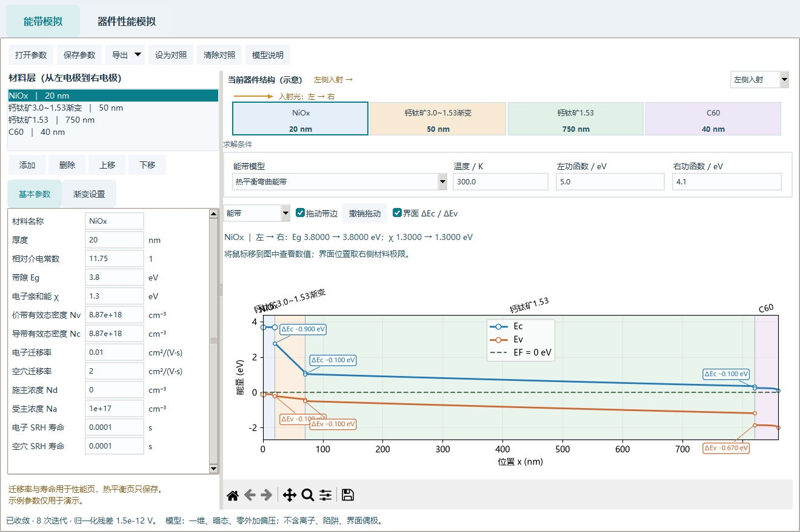
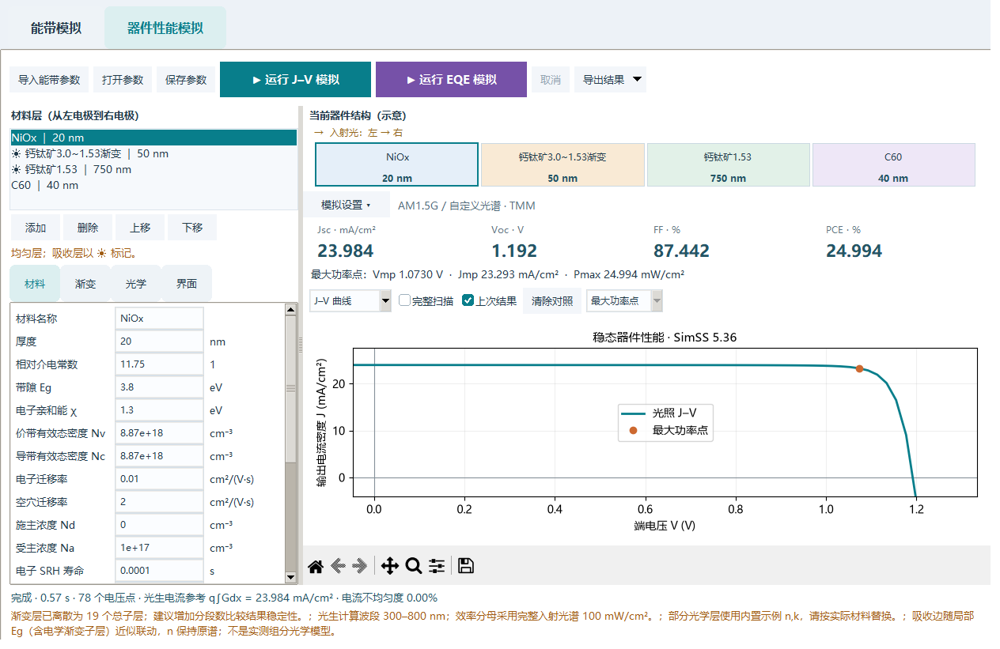
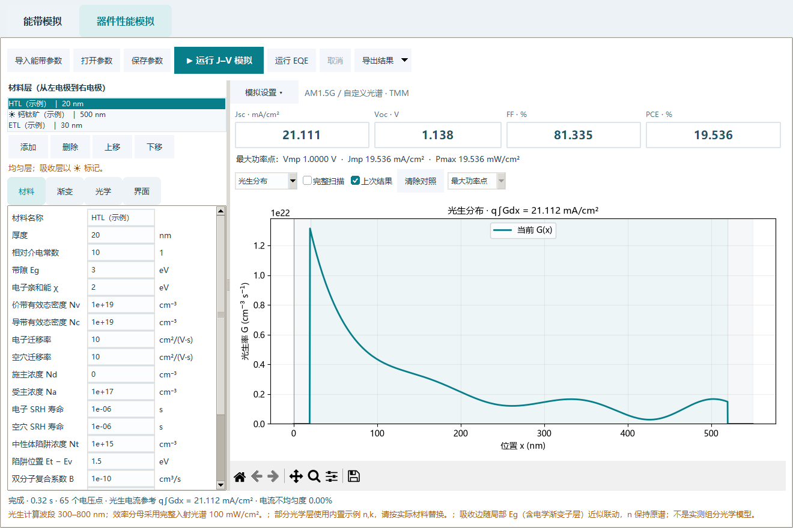
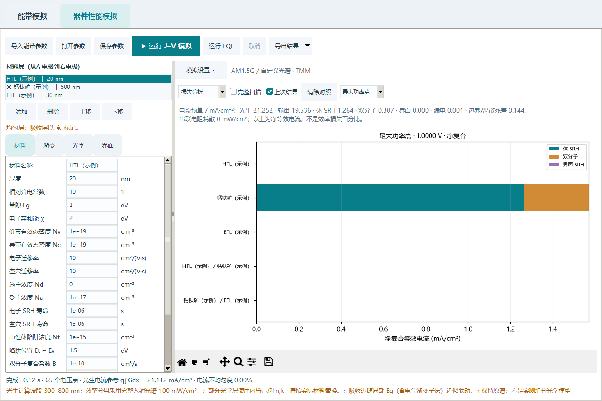
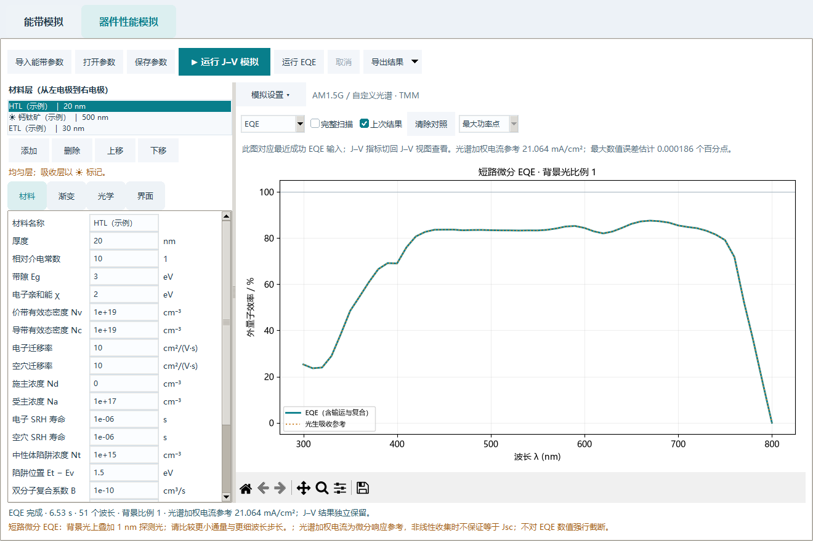
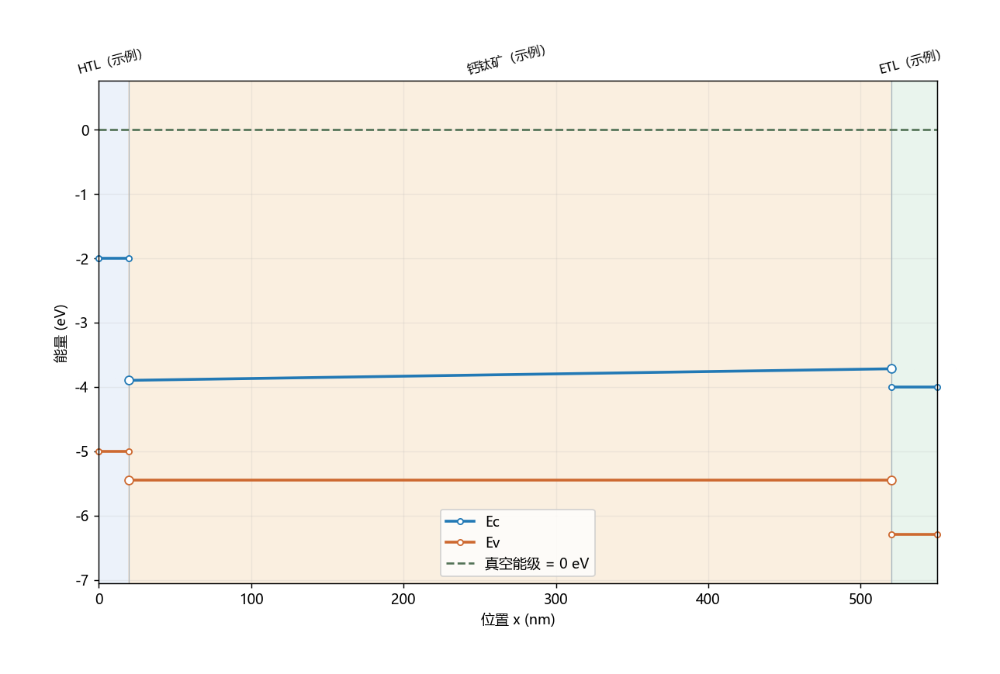
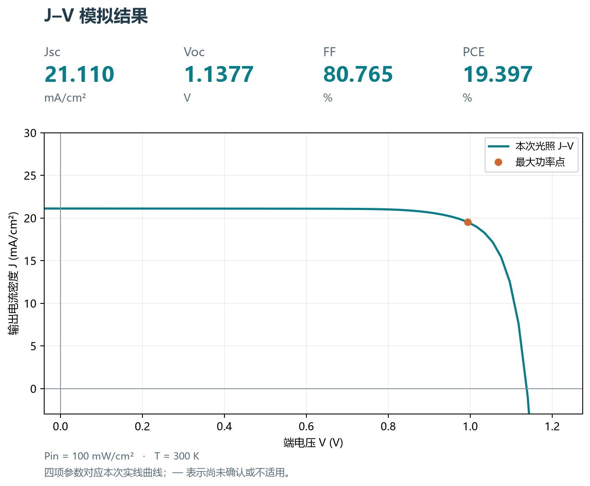

# 钙钛矿器件模拟工作台 · Perovskite Device Studio

Python / Windows 桌面工具，将能带分析和器件性能模拟整合到两个独立页面。能带页查看真空参考排列、自洽热平衡能带、电场与载流子浓度；性能页用 SimSS 计算均匀或渐变器件的稳态 J–V、Jsc、Voc、FF、PCE。版本 **1.3.3**。

1.3.3 更新：两个页面的材料列表显示 5 行，新增随当前输入更新的器件结构图，标注名称、厚度及入射方向；小窗口自动调整结构图位置。J–V / EQE 运行按钮大小一致，分别使用青色与紫色；辅助按钮缩小，J–V 四项指标改为无大边框的紧凑布局，保留大号数值，为图表腾出空间。新增 [器件结构参数库](device_structures/README.md)，收录 Air 入射、3.0→1.53 eV 渐变器件的原始参数。详见 [更新记录](CHANGELOG.md)。

双击 `start.bat`，或执行 `python run.py`。依赖：`pip install -r requirements.txt`。

Windows 打包版：双击 `dist/PerovskiteDeviceStudio.exe`，无需安装 Python 或 SimSS。可单独复制 EXE 到其他 Windows 64 位电脑运行。旧版 `PerovskiteBandTool.exe` 不再作为当前版本入口。

[下载 Windows 1.3.3 单文件版](https://github.com/mumium/perovskite-device-studio/releases/download/v1.3.3/PerovskiteDeviceStudio.exe) · [下载文件夹版 ZIP](https://github.com/mumium/perovskite-device-studio/releases/download/v1.3.3/PerovskiteDeviceStudio-1.3.3-portable.zip) · [版本发布页](https://github.com/mumium/perovskite-device-studio/releases/tag/v1.3.3)

重新打包：安装项目依赖及 `pyinstaller`，再运行 `build_exe.bat`。程序为单文件无控制台版本，首次启动需要解压运行依赖，可能稍慢。

## 项目目录

| 目录或入口 | 内容 |
| --- | --- |
| `run.py` / `start.bat` | 启动桌面工具；也可运行 `python -m perovskite_studio` |
| `perovskite_studio/` | 程序源码：界面、能带、电学性能及光学模型 |
| `tests/` | 模型与真实桌面界面测试 |
| `device_structures/` | 可复用的器件参数库 |
| `research/` | 研究报告、性能表、输入及原始曲线数据索引 |
| `docs/` | 模型说明；页面预览图在 `docs/images/` |
| `packaging/` | Windows 程序打包配置 |
| `scripts/` | 求解器源码准备等维护脚本 |
| `assets/` / `vendor/` | 图标、光谱、光学数据与 SimSS 求解器 |

## 器件结构与参数文件

可复用结构统一保存在 [device_structures](device_structures/README.md)，以后新增 JSON 可继续加入此目录。性能页「打开参数」默认浏览这个目录，打包版也内置该参数库。

两个页面的左侧材料列表可一次显示 5 层；结构图按左到右顺序显示当前层的名称和厚度，选中层高亮。修改名称或厚度会即时更新结构图，增删、排序、导入和打开参数后同步更新。方块宽度为示意，实际厚度以标注为准；层数较多时支持横向滚动。窗口较矮时，结构图移到左侧编辑区，为结果曲线留出空间。

性能页箭头跟随「光谱与光学 → 照射方向」；能带页可单独选择示意方向，并随能带项目保存，**能带求解仍为暗态**。结构图对应当前编辑输入，保留的 J–V / EQE 曲线仍对应最近成功计算的参数快照。

## 研究结果与完整源数据

[2026-10-15 研究结果索引](research/2026-10-15/README.md) 包含两次双层厚度优化，以及 800 nm 单层与 640/160 nm 双层的性能、J–V、EQE 和积分电流对照。

[下载全部报告与完整源数据](https://github.com/mumium/perovskite-device-studio/releases/tag/research-2026-10-15)。解压后双击 `开始查看.html`，即可离线查看，无需安装 Python 或模拟软件。原参数结果与光学参考值敏感性检查分开保存，真实宽带隙材料的光学常数仍需按组分验证。

## 器件性能模拟

点击顶部「器件性能模拟」页签。页面初始复制当前三层示例，材料参数与能带页独立，可自由填写文本框（支持科学计数法）。

1. 在能带页设好器件后，点击性能页「从能带页导入参数」。导入复制层顺序、材料参数、温度和电极功函数，按最小带隙初选吸收层，并按功函数初选电极方向和选择性接触；请自行核对。后续修改不会自动同步到另一页。
2. 逐层检查左侧「材料」，勾选「本层产生光生载流子」。未勾选层仍参与光学吸收和干涉，但不产生自由载流子。「光学」选择本层 n,k、导入数据及吸收边联动模式；初始 PTAA/MAPI/C60 仅为示例映射。「渐变」编辑 Eg、Nd、Na、χ 的模式与右端值。「界面」设置本层与右侧材料之间的陷阱，Nt=0 关闭。
3. 在右侧「光谱与光学」选择光谱 TMM 或手动 G。新页面默认 AM1.5G、左侧入射、300–800 nm，**入射基底 ITO、前透明电极 ITO/200 nm、背电极 Ag/100 nm**；可自行修改。「光照与扫描」设置完整入射功率密度和电压，默认 -0.04 至 1.5 V、步长 **0.02 V**。「电极与电阻」设置功函数、接触速度、阳极方向与电阻；「计算设置」设置网格、超时和渐变分段数（默认 16）。模拟设置默认折叠，J–V / EQE 开始时收起，完成、失败、取消后保持折叠；点击「模拟设置 ▾」可手动展开，表单支持滚动。
4. 点击顶部青色「▶ 运行 J–V 模拟」。计算在后台运行，可取消或切换页面。完成后显示 J–V、Jsc、Voc、FF、效率及最大功率点；图表选项可切换「入射光谱」「光生分布」「损失分析」。默认聚焦光伏区域，勾选「完整扫描」查看全部点。第二次成功计算后自动叠加前次曲线、显示指标差值，可取消「上次结果」或「清除对照」。EQE 使用单独的「运行 EQE」按钮。
5. 顶部「打开参数／保存参数」使用独立性能 JSON，不影响能带项目格式；「导出结果」菜单输出当前视图 CSV、完整结果 JSON、PNG/SVG。结果 JSON 包含输入、光谱、n,k 数据及指纹、G(x)、曲线、指标、警告、离散子层和日志。自定义 CSV 数据内嵌在参数项目中，移动电脑不需另带源文件。**修改输入、导入或打开项目均保留上次成功结果**；运行中、失败或取消时也保留。只有新计算成功才更新。导出对应成功结果的输入快照。

### 光谱怎样影响 J–V

计算流程是 **入射光谱 → 多层光场与吸收 → G(x) → 载流子输运与复合 → J–V**。n 决定光传播和干涉，k 决定吸收；光子能量为 hc/λ，吸收的光子在勾选的光生层按每光子一对载流子转为 G(x)。随后 SimSS 解电学方程，计算能有多少载流子被电极收集。未勾选层中的吸收是寄生损失。

- 内置光谱采用 ASTM G173 的 **Global Tilt（AM1.5G）**列，完整范围 280–4000 nm。标准原始积分约 1000.37 W/m²；程序将完整光谱统一缩放到填写的 Pin，默认 100 mW/cm²（1000 W/m²）。光源数据和 n,k 来源见 [光学数据说明](assets/optics/PROVENANCE.md)。
- 薄膜光学使用 SimSS 原生**法向入射传输矩阵法（TMM）**，考虑折射、反射、吸收及薄膜干涉，以 1 nm 波长步长积分。光学堆叠为：半无限入射基底 → 可选前透明电极 → 左侧所列电学材料层 → 背电极。右侧入射时反转电学层与对应接触/梯度，在结果中仍按原左到右坐标显示。额外光学电极只提供光学边界，电学接触仍由功函数与接触速度决定，避免与已有电学层重复计入同一电极。
- 默认只算 300–800 nm 的光生，因为内置整套 n,k 的共同覆盖范围到 800 nm；**效率分母仍采用完整光谱的 Pin**。若要考虑更长波长吸收，须为每层和光学边界导入覆盖更宽波段的 n,k，再扩大波段。数据不足时明确报错，不外推。
- n,k CSV 三列为 `wavelength_nm,n,k`，光谱 CSV 两列为 `wavelength_nm,irradiance_W_m2_nm`；可有表头，波长须严格递增。n>0、k≥0，辐照度≥0；源数据可不等间距，求解前线性插值。参考 [n,k 格式示例](assets/optics/example_nk.csv) 和 [光谱格式示例](assets/optics/example_spectrum.csv)，仅供展示文件格式。
- 「固定 n,k」保持测量数据，改变 Eg 不改变光生吸收。「吸收边联动（近似）」由本层参考 Eg 和各子层局部 Eg 重映射吸收系数，低于局部带隙的光生吸收置零，n 保持原谱。新建示例的吸收层默认开启联动，MAPI 示例参考 Eg=1.55 eV；旧项目缺少此设置时保持固定模式。亲和能/掺杂不自动改变 n,k；具体公式和边界见 [模型细节](docs/MODEL_DETAILS.md)。
- 保留「手动光生率 G」模式：所有勾选层使用同一均匀 G，G 与 Pin 须自行对应。旧性能项目未含光学设置时自动使用手动模式，保持原结果含义。光谱模式会禁用手动 G 输入。

该光学模型针对平面薄膜法向入射，不模拟散射、纹理、角度分布或光致材料变化。电学带隙与实测吸收谱需由使用者保持一致；内置示例的效率不是对具体样品的预测。

### 界面缺陷与界面复合

左侧选择材料 →「界面」填写与右侧材料之间的缺陷浓度 **Nt/cm⁻²**、电子和空穴捕获系数 **Cn、Cp/cm³·s⁻¹**，选择中性、受主或施主。这里的捕获系数独立于体寿命，增大非零 Nt 会增强相应捕获过程。

默认 Nt=0；开启后优先使用「能级自动取两侧共同禁带中点」。手动能级输入为 **真空以下的正深度/eV**，并非体陷阱的 Et−Ev，必须位于两侧共同禁带内。最后一层没有右侧界面，其设置不参与计算。渐变拆分产生的虚拟界面始终 Nt=0；真实界面在分段和左右入射时保持对应关系。高浓度带电陷阱可能使求解变得困难，可先从中性、小浓度与较窄电压范围检查收敛。

### 带隙与吸收边联动（基础版）

选择吸收层 →「光学」→「吸收边联动（近似）」，填写**原始 n,k 对应的参考 Eg**。改变材料 Eg 时保持此参考值不变，再运行 J–V。渐变层按每个子层的局部 Eg 更新消光系数，因此 G(x) 和短路电流也会响应带隙变化。

基础模型保持源数据短波端为锚点，在光子能量轴上重映射吸收系数，再换算 k；n 不变。它不满足完整的组分光学模型，不用于代替实测 n,k，也不自动推导组分、折射率或缺陷变化。需要保留测量吸收尾时选择固定模式。手动 G 模式不使用此光学联动。

### 损失分析

运行 J–V 后，将图表切换为「损失分析」，选择短路、最大功率点或开路。图中显示各材料的体 SRH、双分子复合及各真实界面的 SRH **净等效电流**；直接使用 SimSS 的积分输出，并将渐变子层聚合回原材料层。

同时列出光生、输出、漏电、边界/离散残差和串联电阻耗散。**净复合电流不是效率损失百分比**；残差不等于纯接触损失，包含边界处理与离散积分差异。未扫描到开路点时不外推该工作点。CSV 导出整个电压扫描中的总量、逐层和逐界面分量；JSON 保留完整分析数组。

### EQE 模拟

右侧「EQE」设置波长步长（默认 10 nm）、探测光子通量（默认 1e14 cm⁻²·s⁻¹）、背景光比例（默认 1；0 为暗态），点击顶部「运行 EQE」。波段沿用「光谱与光学」，最多 251 个波长点，支持进度与取消。

采用上游 [pySIMsalabim EQE](https://github.com/kostergroup/pySIMsalabim/blob/main/pySIMsalabim/experiments/EQE.py) 的背景光加单波长探测思路：在短路下先求背景电流，再逐波长叠加 1 nm 探测光，重新计算光学吸收与电学输运，以 `EQE=ΔJ/(q·ΔΦ)` 得到带符号的微分响应。曲线包含复合与收集损失，同时绘制光生吸收参考。保留异常负值/超过 100% 的值并提示，不强行截断。

EQE 与 J–V 各自保存最近成功快照；**四项指标始终属于最近 J–V**，EQE/损失视图暂时收起指标卡以扩大图表，切回 J–V 恢复。修改参数、计算失败或取消不会覆盖它们。图表选 EQE 时，CSV/JSON/图片导出对应最近 EQE 输入。光谱加权电流为微分响应参考，非线性条件下不保证等于 Jsc；应比较更小探测通量、更细波长步长以及更密网格。

### 模型与单位

- 引擎基于 **SIMsalabim / SimSS 5.36**，本地构建标识为 **5.36-pds1**。它求解一维稳态泊松方程、漂移–扩散与载流子连续性方程；不使用能带页热平衡载流子浓度代替工作态浓度。为多子层修正网格预算并将网格上限设为 2000，物理方程未改变；修改源码随程序提供。
- 支持均匀层，以及 Eg 线性渐变、Nd/Na 线性或对数渐变、χ 独立线性端点或随 Eg 分配。仍要求 **Nc = Nv**（SimSS 只有一个共同态密度参数），不相等时会明确提示。
- 渐变层按指定数量拆为薄子层，端点采样子层为半宽，保留总厚度和接触端精确参数；均匀层不拆分。虚拟子层界面不添加陷阱复合，并按求解器实际网格间距设置 `ν=μ·Vt/Δx`，维持原材料体迁移率；用户填写的界面传输速度只用于真实材料界面。
- 渐变模拟是分段近似，默认 16 段；建议比较 8、16、32 段及更密空间网格的结果，确认指标稳定。不是任意梯度下的精确连续解；强梯度仍可能不收敛。总子层数上限 120，网格不足时自动增大并提示，最多 2000 点；超过限制须减少分段数或材料层数。结果 JSON 保存实际分段与网格设置，便于复现。
- 公共输入仍使用 nm、eV、cm⁻³、cm²/(V·s)、s；新增 G 为 cm⁻³·s⁻¹、B 为 cm³/s、接触与界面传输速度为 cm/s，串并联电阻为面积归一化电阻 Ω·cm²。适配器统一转换为 SI。能级转换为 SimSS 的真空以下正数深度：Ec=χ，Ev=χ+Eg。
- 新页面默认串联电阻 **Rs=0.3 Ω·cm²**、并联电阻 **Rsh=4×10⁴ Ω·cm²**。已有参数文件按其中保存的值加载。EQE 在包含实际串并联电阻的端电压 Vext=0 条件下计算，非零 Rs 时自动求相应内部电压。
- 单能级中性体 SRH 陷阱：输入 Nt 和价带以上的陷阱位置 Et−Ev（0 至本层最小 Eg），使用电子、空穴寿命换算捕获系数 `Cn=1/(τn·Nt)`、`Cp=1/(τp·Nt)`。固定寿命时改变非零 Nt 不改变此稳态中性 SRH 复合；Nt=0 时关闭体 SRH。默认位置为导入时左端带隙中点；渐变时 Et−Ev 在各子层保持相同的输入值，并不自动沿局部带隙取中点。
- 可设置双分子复合 B、真实界面陷阱浓度/能级/类型/捕获系数；体陷阱仍为单能级中性模型，不含离子迁移。内部界面传输速度与陷阱复合为不同输入；最后一层的右界面数值不使用。接触速度 0 表示阻挡相应载流子。
- 电流以正号表示发电。Jsc 在端电压 0 V 插值，Voc 从电流过零点插值，最大功率点在分段线性 J–V 上计算；`FF=100·Pmax/(Voc·Jsc)`、`PCE=100·Pmax/Pin`，功率密度单位 mW/cm²。结果精度受电压步长影响，可缩小步长后比较。
- 扫描必须覆盖 0 V。未覆盖开路点时保留曲线、提示增大扫描终点，并且不报告 Voc、FF、PCE 和未经确认的最大功率。暗态或未获得正向光伏输出时效率不适用。求解失败时不采用部分曲线。
- 展示的电流不均匀度为 RMS 电流误差除以 `max(|Jint|, q∫Gdx, 1e-12 A/m²)` 后在整次扫描取最大值。结果 JSON 中也保留绝对 RMS 电流误差（A/m²）。
- 手动模式下 **G 与入射功率密度需要用户自行对应**。默认手动 G=3e21 cm⁻³·s⁻¹ 只供演示；光谱模式由输入光谱与 n,k 计算 G(x)。两种模式的示例参数均不代表具体样品的测量值。温度不会自动更新带隙等材料输入。

### 求解器与打包

项目已包含 Windows 版 `vendor/simsalabim/simss.exe`，无需另装编译器或手动选择求解器。每次运行使用独立临时目录并在结束后清理，支持中文项目路径。Windows 打包版内含求解器、模板、上游说明、许可证和来源信息。

上游：[SIMsalabim](https://github.com/kostergroup/SIMsalabim)，版本、修改说明、SHA256 和编译命令见 [PROVENANCE.md](vendor/simsalabim/PROVENANCE.md)，对应源码在 `vendor/simsalabim/source`。输入模板在临时目录生成运行副本。其他平台需使用所附修改源码构建 `simss` 并设置执行权限，不能直接用未修正网格的上游二进制替换。

运行 `python -m unittest discover -p "test_*.py"` 可检查原能带功能、单位转换、SRH 映射、指标提取，以及真实 SimSS 的暗态零偏压、光生电流参考、网格稳定性、寿命敏感性、渐变分段收敛、虚拟界面体迁移率、页面独立性、结果保留与对照、小屏幕布局、后台计算与导出。光学测试覆盖标准光谱功率、SI 转换、无吸收极限、光子预算、光照功率缩放、左右入射镜像、自定义数据迁移与光谱/G(x) 导出。

1.3.2 版本共 62 项测试，包括真实界面复合及镜像映射、带隙—光生联动、损失工作点、EQE 与独立单色光计算对照、非零串联电阻的端电压短路条件、探测通量稳定性、零吸收极限、成功快照与导出、226 有限恢复、诊断保留和求解器副本校验。

## 能带分析与读数

图上方「查看」可切换 **能带 / 电势 / 电场 / 载流子浓度**，切换视图不修改参数。电势、电场和浓度仅在热平衡模式下可用；切到真空参考排列会自动回到能带视图。

- 鼠标在图中移动时，上方显示所在材料、位置 x、Ec、Ev 和 Eg；热平衡下同时显示 φ、E、电子浓度 n 和空穴浓度 p。读数在各材料内部插值，不跨界面混合；精确界面默认取右侧材料极限。
- 能带图可勾选界面 ΔEc / ΔEv 标注，定义为 **右侧材料带边 − 左侧材料带边**，单位 eV。正负表示带边台阶方向，不直接等同于某种载流子的输运势垒。
- 电场使用 **E = −dφ/dx**，由重建到材料端点的静电势在每层内部数值求导，单位 V/cm，正方向从器件左侧指向右侧。材料界面的两侧电场可不同；不会将电子亲和能或带隙跳变当作静电场。
- 载流子浓度单位 cm⁻³，采用对数纵轴，沿用当前泊松–玻尔兹曼模型的统计近似。对照曲线支持四种视图；拖动仅在能带视图启用。
- CSV 曲线导出在热平衡模式新增 `E_V_per_cm` 列，仍在原网格中心采样。保存图片导出当前选中的视图。

## 鼠标拖动能带

勾选图上方「鼠标拖动能带」，关闭工具栏的缩放/平移模式：

- **拖动蓝色 Ec 或橙色 Ev 曲线中间**：上下移动该层整条带边。
- **拖动左右端点圆点**：只调整该侧材料带边，形成或改变沿厚度方向的渐变。
- 拖动时自动选中材料层，实时更新左侧的 Eg、χ 和右侧终点；图上方也显示左右端点值。
- **松开鼠标**：应用参数并重算；**Esc**：取消本次拖动；**撤销拖动**：恢复上一次拖动前参数，可连续撤销。手动修改参数或层结构会清空撤销记录。

拖动会自动切换电子亲和能到「独立端点」模式：χ(t)=χ左+(χ右-χ左)t，此时导带分配比例 α 不参与计算。Eg(t) 与 χ(t) 独立描述两条带边，避免强制用单一 α 表达任意拖动。原有「随带隙分配」模式仍保留，可在渐变设置中选择。

映射规则按真空参考定义：Ec=-χ，Ev=-χ-Eg。拖 Ec 会同步改变 χ 和 Eg，保持 Ev 的真空参考位置；拖 Ev 会改变 Eg，保持 χ。掺杂、介电常数、态密度、迁移率和寿命不会由拖动反推。

在**真空参考排列**中，最终带边与拖动目标一致。在**热平衡模式**中，拖动期间暂固定原静电势以预览材料参数变化，松开后重新自洽求解；电势重新分布可能使两条带边都变化，最终曲线不保证经过鼠标指定位置。这不是对平衡能带的唯一参数反演。

带隙不能小于或等于零，电子亲和能不能小于零；越界时保留最近有效预览。若松开后无法收敛，会恢复拖动前的参数和有效曲线。

左侧编辑层参数，停止输入 0.6 秒后自动刷新。支持层的增删排序、参数 JSON 保存/读取、参数与曲线 CSV 导出、PNG/SVG 图片导出、前后方案对照。数值可输入科学计数法，例如 `1e16`。

## 渐变带隙与渐变掺杂

选择材料层 → 打开「渐变设置」页签 → 选择模式并填写右侧终点。起点来自「基本参数」中的 Eg、Nd、Na，方向始终是当前层的左侧到右侧。均匀模式忽略终点。

- 带隙：均匀或线性。例如钙钛矿层左端 Eg=1.55 eV，右端 Eg=1.8 eV。
- 施主/受主：各自独立选择均匀、线性、对数。例如 Na 从 1e14 渐变至 1e17 cm⁻³。对数渐变要求两端严格大于零；含零浓度请用线性。
- 导带分配比例 α：0 保持电子亲和能不变（只改变真空参考价带），1 保持真空参考价带不变（只改变导带），0.5 均分。它是用户指定的带边模型，并不是仅由 Eg 能确定的材料属性。

若 t 为层内归一化位置，线性值为 A(t)=A左+(A右-A左)t；对数浓度为 exp[(1-t)ln A左+t ln A右]。
电子亲和能按 χ(t)=χ左-α[Eg(t)-Eg左] 变化。在平衡态下，静电势会进一步自洽调整两条带边。掺杂渐变只改变平衡态能带，不改变真空参考排列。

新 JSON 项目使用版本 3，同时兼容版本 1、2；旧项目按原有带隙分配模型读取。参数 CSV 包含渐变模式、终点、分配比例、电子亲和能模式和独立 χ 终点；曲线 CSV 包含沿深度的 Eg、χ、Nd、Na。平衡态导出曲线采样于网格中心，绘图另外补上几何端点，便于精确编辑材料两侧。

在项目目录运行 `python -m unittest discover -p "test_*.py"` 可检查渐变模型、拖动映射、均匀极限、鼠标交互、取消/撤销、求解失败恢复和保存导出。界面测试会短暂打开 Tk 窗口。

两种模式：
- 真空参考能级排列：Ec=-χ，Ev=-χ-Eg，真空能级为 0。
- 热平衡弯曲能带：一维有限体积泊松-玻尔兹曼求解，EF=0；Ec=-χ-φ，Ev=Ec-Eg。界面网格对齐，用串联介电电阻计算面通量。左右边界 φ=-W，W 为相应电极功函数。假定浅掺杂完全电离。

示例材料和参数仅用于演示，不能作为具体配方的测量结果。温度改变统计分布，材料本身的带隙、态密度等仍按输入值使用，不自动加入温度依赖。

在能带页中，迁移率及 SRH 寿命只保存在参数集中，不影响热平衡静电求解；没有光照、外加偏压、离子、陷阱电荷、界面偶极、界面复合或电流求解。能带页本身不能预测效率/J–V，不能唯一反推全部参数。器件性能页的适用范围见前文。高载流子浓度时玻尔兹曼近似有限，程序会提示。

曲线的能量零点随模式变化，不应跨模式直接比较。电势为上述 EF 参考下的模型电势。参数 CSV 使用 cm 系单位（见表头）；求解器内部使用 SI。JSON 项目同时保存温度、功函数和模式；用于复现计算时应一并保留。导出不是 SCAPS 原生输入格式。

后续可扩展沿组分变化的光学常数、界面复合与带先验约束的反演。

## 公司电脑运行诊断（1.3.1）

- 文件夹版：运行 `build_exe.bat --folder` 生成 `dist/PerovskiteDeviceStudio-portable/`。迁移时复制整个文件夹，运行其中的 `PerovskiteDeviceStudio.exe`，不要单独移动内部 EXE。此版本不在每次启动时将程序解压到随机临时目录，适合与单文件版对照。模拟输入仍使用独立临时目录。
- EQE 要求多个独立短路求解，背景计算和每个波长均需启动 SimSS。J–V 与 EQE 均仅对退出码 226 自动重新启动，最多总计三次；输入和总超时不变，普通不收敛、权限错误不重试，取消可中断等待。恢复成功也会在提示和导出结果的 `runtime_recoveries` 中记录，不接受失败尝试的部分结果。
- Windows 打包版将求解器按 SHA256 校验复制到 `%LOCALAPPDATA%/PerovskiteDeviceStudio/engines/<hash>/simss.exe`，从固定位置启动，减少反复从单文件随机解压目录启动。副本损坏时重新复制；缓存目录不可写时使用原路径。不同求解器构建不会共用副本。
- 每次启动前清理上次输出；错误信息分别显示本次错误输出、控制台输出及计算日志，标明 EQE 背景或具体波长。
- 求解器失败时自动保存 ZIP 到 `%LOCALAPPDATA%/PerovskiteDeviceStudio/diagnostics/`，不可写时尝试系统临时目录下的 `PerovskiteDeviceStudio-diagnostics/`。报错框会显示实际位置。包内包含当前器件输入、光谱、n,k、完整 stdout/stderr、计算日志及版本信息。请自行决定是否分享其中的材料参数。正常运行与主动取消不会保存诊断包。
- 226 应与普通数值不收敛区分；仅凭退出码或上次日志无法确定企业安全软件、运行库兼容性等具体根因。比较同版本、同参数的单文件版和文件夹版，并保留失败包。

## J–V 曲线和四项参数导出

在图表中选择「J–V 曲线」，点击「导出结果」：

- 「图像与参数 PNG / SVG」生成固定尺寸报告，包含 J–V 曲线、Jsc（mA/cm²）、Voc（V）、FF（%）、PCE（%）、入射功率和温度。参数对应本次实线曲线；若显示上次结果，则保留虚线对照。未确认或不适用的指标用 — 表示。
- 「当前曲线与参数 CSV」前两列保留电压、电流，增加四项参数列；每行记录同一曲线的参数，NaN 表示未确认或不适用。
- 「完整结果 JSON」保留曲线、四项参数及完整计算快照。修改页面输入不会改变上一次成功结果的导出内容。

