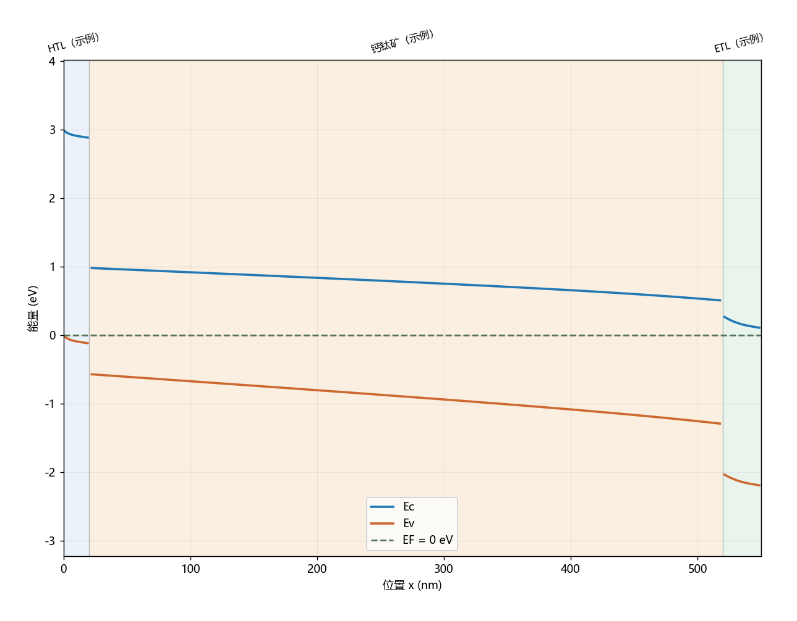
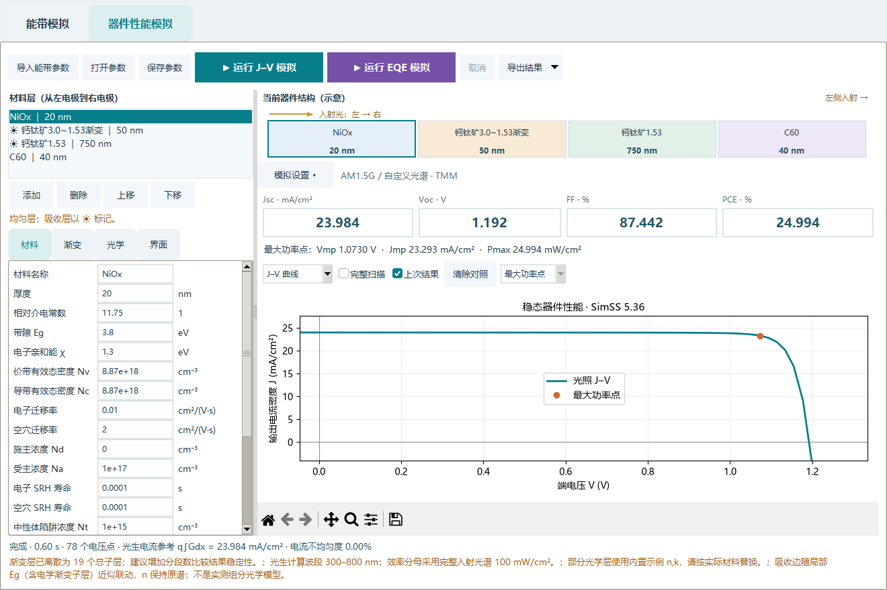

# 钙钛矿器件模拟工作台 · Perovskite Device Studio

Python / Windows 桌面工具，将能带分析和器件性能模拟整合到两个独立页面。能带页查看真空参考排列、自洽热平衡能带、电场与载流子浓度；性能页用 SimSS 计算均匀或渐变器件的稳态 J–V、Jsc、Voc、FF、PCE。版本 **1.1.0**。

本版新增：大号运行按钮和主选项卡、小屏幕滚动与折叠设置、0.02 V 默认步长、保留上次结果与自动曲线对照，以及带隙／掺杂／电子亲和能渐变的性能模拟。详见 [更新记录](CHANGELOG.md)。

双击 `start.bat`，或执行 `python app.py`。依赖：`pip install -r requirements.txt`。

Windows 打包版：双击 `dist/PerovskiteDeviceStudio.exe`，无需安装 Python 或 SimSS。可单独复制 EXE 到其他 Windows 64 位电脑运行。旧版 `PerovskiteBandTool.exe` 不再作为当前版本入口。

[下载 Windows 1.1.0 单文件版](https://github.com/mumium/perovskite-band-tool/releases/download/v1.1.0/PerovskiteDeviceStudio.exe) · [版本发布页](https://github.com/mumium/perovskite-band-tool/releases/tag/v1.1.0)

重新打包：安装项目依赖及 `pyinstaller`，再运行 `build_exe.bat`。程序为单文件无控制台版本，首次启动需要解压运行依赖，可能稍慢。

## 器件性能模拟

点击顶部「器件性能模拟」页签。页面初始复制当前三层示例，材料参数与能带页独立，可自由填写文本框（支持科学计数法）。

1. 在能带页设好器件后，点击性能页「从能带页导入参数」。导入复制层顺序、材料参数、温度和电极功函数，按最小带隙初选吸收层，并按功函数初选电极方向和选择性接触；请自行核对。后续修改不会自动同步到另一页。
2. 逐层检查「材料参数」，勾选「本层产生光生载流子」。可选择多个吸收层，所有勾选层采用相同的均匀光生率 G；未勾选层的 G 为零。可以添加、删除和排序材料层。在「渐变设置」中编辑 Eg、Nd、Na、χ 的模式和右端值，也可以从能带页完整导入渐变参数。
3. 在右侧「光照与扫描」填写 G、入射功率密度和电压扫描范围；默认扫描 -0.04 至 1.5 V，步长 **0.02 V**。「电极与电阻」填写左右功函数、左右电子/空穴接触速度、阳极方向、串并联电阻；「计算设置」填写网格点数、超时和每个渐变层的分段数（默认 16）。小屏幕默认收起模拟设置，点击「展开模拟设置」即可填写；表单支持滚动，收起设置后扩大曲线。
4. 点击右上方大号青色「▶ 运行 J–V 模拟」。计算在后台运行，可取消或切换回能带页。完成后显示 J–V、Jsc、Voc、FF、效率及最大功率点。默认聚焦光伏区域，勾选「显示完整扫描范围」可查看全部点。第二次成功计算后自动叠加前一次曲线并显示指标差值，可取消「叠加上次结果」或点击「清除对照」。
5. 「保存性能参数／打开性能参数」使用独立的性能 JSON，不影响原能带项目格式；「导出 J–V CSV」输出端电压和正向发电电流密度；「保存结果 JSON」同时保留输入、曲线、指标、警告、引擎版本、离散子层和日志。可导出 PNG/SVG。**修改输入、导入参数或打开项目均保留上次成功结果**；运行中、失败或取消时也保留。只有新计算成功才更新曲线和指标。导出始终对应当前显示的成功结果快照，而不是尚未计算的输入。

### 模型与单位

- 引擎基于 **SIMsalabim / SimSS 5.36**，本地构建标识为 **5.36-pds1**。它求解一维稳态泊松方程、漂移–扩散与载流子连续性方程；不使用能带页热平衡载流子浓度代替工作态浓度。为多子层修正网格预算并将网格上限设为 2000，物理方程未改变；修改源码随程序提供。
- 支持均匀层，以及 Eg 线性渐变、Nd/Na 线性或对数渐变、χ 独立线性端点或随 Eg 分配。仍要求 **Nc = Nv**（SimSS 只有一个共同态密度参数），不相等时会明确提示。
- 渐变层按指定数量拆为薄子层，端点采样子层为半宽，保留总厚度和接触端精确参数；均匀层不拆分。虚拟子层界面不添加陷阱复合，并按求解器实际网格间距设置 `ν=μ·Vt/Δx`，维持原材料体迁移率；用户填写的界面传输速度只用于真实材料界面。
- 渐变模拟是分段近似，默认 16 段；建议比较 8、16、32 段及更密空间网格的结果，确认指标稳定。不是任意梯度下的精确连续解；强梯度仍可能不收敛。总子层数上限 120，网格不足时自动增大并提示，最多 2000 点；超过限制须减少分段数或材料层数。结果 JSON 保存实际分段与网格设置，便于复现。
- 公共输入仍使用 nm、eV、cm⁻³、cm²/(V·s)、s；新增 G 为 cm⁻³·s⁻¹、B 为 cm³/s、接触与界面传输速度为 cm/s，串并联电阻为面积归一化电阻 Ω·cm²。适配器统一转换为 SI。能级转换为 SimSS 的真空以下正数深度：Ec=χ，Ev=χ+Eg。
- 单能级中性体 SRH 陷阱：输入 Nt 和价带以上的陷阱位置 Et−Ev（0 至本层最小 Eg），使用电子、空穴寿命换算捕获系数 `Cn=1/(τn·Nt)`、`Cp=1/(τp·Nt)`。固定寿命时改变非零 Nt 不改变此稳态中性 SRH 复合；Nt=0 时关闭体 SRH。默认位置为导入时左端带隙中点；渐变时 Et−Ev 在各子层保持相同的输入值，并不自动沿局部带隙取中点。
- 可设置每层双分子复合系数 B；不含离子、带电陷阱、界面陷阱复合、光学干涉或光谱吸收计算。内部界面传输速度可以填写，最后一层的右界面数值不使用。接触速度 0 表示阻挡相应载流子。
- 电流以正号表示发电。Jsc 在端电压 0 V 插值，Voc 从电流过零点插值，最大功率点在分段线性 J–V 上计算；`FF=100·Pmax/(Voc·Jsc)`、`PCE=100·Pmax/Pin`，功率密度单位 mW/cm²。结果精度受电压步长影响，可缩小步长后比较。
- 扫描必须覆盖 0 V。未覆盖开路点时保留曲线、提示增大扫描终点，并且不报告 Voc、FF、PCE 和未经确认的最大功率。暗态或未获得正向光伏输出时效率不适用。求解失败时不采用部分曲线。
- 展示的电流不均匀度为 RMS 电流误差除以 `max(|Jint|, q∫Gdx, 1e-12 A/m²)` 后在整次扫描取最大值。结果 JSON 中也保留绝对 RMS 电流误差（A/m²）。
- **G 与入射功率密度需要用户自行对应**。默认 G=3e21 cm⁻³·s⁻¹、Pin=100 mW/cm² 只供演示，不等同于经过 AM1.5G 光谱与光学模型计算的预测；不能将示例效率当成具体样品的实测性能。温度不会自动更新带隙等材料输入。

### 求解器与打包

项目已包含 Windows 版 `vendor/simsalabim/simss.exe`，无需另装编译器或手动选择求解器。每次运行使用独立临时目录并在结束后清理，支持中文项目路径。Windows 打包版内含求解器、模板、上游说明、许可证和来源信息。

上游：[SIMsalabim](https://github.com/kostergroup/SIMsalabim)，版本、修改说明、SHA256 和编译命令见 [PROVENANCE.md](vendor/simsalabim/PROVENANCE.md)，对应源码在 `vendor/simsalabim/source`。输入模板在临时目录生成运行副本。其他平台需使用所附修改源码构建 `simss` 并设置执行权限，不能直接用未修正网格的上游二进制替换。

运行 `python -m unittest discover -p "test_*.py"` 可检查原能带功能、单位转换、SRH 映射、指标提取，以及真实 SimSS 的暗态零偏压、光生电流参考、网格稳定性、寿命敏感性、渐变分段收敛、虚拟界面体迁移率、页面独立性、结果保留与对照、小屏幕布局、后台计算与导出。

## 能带分析与读数

图上方「查看」可切换 **能带 / 电势 / 电场 / 载流子浓度**，切换视图不修改参数。电势、电场和浓度仅在热平衡模式下可用；切到真空参考排列会自动回到能带视图。

- 鼠标在图中移动时，上方显示所在材料、位置 x、Ec、Ev 和 Eg；热平衡下同时显示 φ、E、电子浓度 n 和空穴浓度 p。读数在各材料内部插值，不跨界面混合；精确界面默认取右侧材料极限。
- 能带图可勾选界面 ΔEc / ΔEv 标注，定义为 **右侧材料带边 − 左侧材料带边**，单位 eV。正负表示带边台阶方向，不直接等同于某种载流子的输运势垒。
- 电场使用 **E = −dφ/dx**，由重建到材料端点的静电势在每层内部数值求导，单位 V/cm，正方向从器件左侧指向右侧。材料界面的两侧电场可不同；不会将电子亲和能或带隙跳变当作静电场。
- 载流子浓度单位 cm⁻³，采用对数纵轴，沿用当前泊松–玻尔兹曼模型的统计近似。对照曲线支持四种视图；拖动仅在能带视图启用。
- CSV 曲线导出在热平衡模式新增 `E_V_per_cm` 列，仍在原网格中心采样。保存图片导出当前选中的视图。

## 鼠标拖动能带

勾选图上方「鼠标拖动能带」，关闭工具栏的缩放/平移模式：

- **拖动蓝色 Ec 或橙色 Ev 曲线中间**：上下移动该层整条带边。
- **拖动左右端点圆点**：只调整该侧材料带边，形成或改变沿厚度方向的渐变。
- 拖动时自动选中材料层，实时更新左侧的 Eg、χ 和右侧终点；图上方也显示左右端点值。
- **松开鼠标**：应用参数并重算；**Esc**：取消本次拖动；**撤销拖动**：恢复上一次拖动前参数，可连续撤销。手动修改参数或层结构会清空撤销记录。

拖动会自动切换电子亲和能到「独立端点」模式：χ(t)=χ左+(χ右-χ左)t，此时导带分配比例 α 不参与计算。Eg(t) 与 χ(t) 独立描述两条带边，避免强制用单一 α 表达任意拖动。原有「随带隙分配」模式仍保留，可在渐变设置中选择。

映射规则按真空参考定义：Ec=-χ，Ev=-χ-Eg。拖 Ec 会同步改变 χ 和 Eg，保持 Ev 的真空参考位置；拖 Ev 会改变 Eg，保持 χ。掺杂、介电常数、态密度、迁移率和寿命不会由拖动反推。

在**真空参考排列**中，最终带边与拖动目标一致。在**热平衡模式**中，拖动期间暂固定原静电势以预览材料参数变化，松开后重新自洽求解；电势重新分布可能使两条带边都变化，最终曲线不保证经过鼠标指定位置。这不是对平衡能带的唯一参数反演。

带隙不能小于或等于零，电子亲和能不能小于零；越界时保留最近有效预览。若松开后无法收敛，会恢复拖动前的参数和有效曲线。

左侧编辑层参数，停止输入 0.6 秒后自动刷新。支持层的增删排序、参数 JSON 保存/读取、参数与曲线 CSV 导出、PNG/SVG 图片导出、前后方案对照。数值可输入科学计数法，例如 `1e16`。

## 渐变带隙与渐变掺杂

选择材料层 → 打开「渐变设置」页签 → 选择模式并填写右侧终点。起点来自「基本参数」中的 Eg、Nd、Na，方向始终是当前层的左侧到右侧。均匀模式忽略终点。

- 带隙：均匀或线性。例如钙钛矿层左端 Eg=1.55 eV，右端 Eg=1.8 eV。
- 施主/受主：各自独立选择均匀、线性、对数。例如 Na 从 1e14 渐变至 1e17 cm⁻³。对数渐变要求两端严格大于零；含零浓度请用线性。
- 导带分配比例 α：0 保持电子亲和能不变（只改变真空参考价带），1 保持真空参考价带不变（只改变导带），0.5 均分。它是用户指定的带边模型，并不是仅由 Eg 能确定的材料属性。

若 t 为层内归一化位置，线性值为 A(t)=A左+(A右-A左)t；对数浓度为 exp[(1-t)ln A左+t ln A右]。
电子亲和能按 χ(t)=χ左-α[Eg(t)-Eg左] 变化。在平衡态下，静电势会进一步自洽调整两条带边。掺杂渐变只改变平衡态能带，不改变真空参考排列。

新 JSON 项目使用版本 3，同时兼容版本 1、2；旧项目按原有带隙分配模型读取。参数 CSV 包含渐变模式、终点、分配比例、电子亲和能模式和独立 χ 终点；曲线 CSV 包含沿深度的 Eg、χ、Nd、Na。平衡态导出曲线采样于网格中心，绘图另外补上几何端点，便于精确编辑材料两侧。

在项目目录运行 `python -m unittest discover -p "test_*.py"` 可检查渐变模型、拖动映射、均匀极限、鼠标交互、取消/撤销、求解失败恢复和保存导出。界面测试会短暂打开 Tk 窗口。

两种模式：
- 真空参考能级排列：Ec=-χ，Ev=-χ-Eg，真空能级为 0。
- 热平衡弯曲能带：一维有限体积泊松-玻尔兹曼求解，EF=0；Ec=-χ-φ，Ev=Ec-Eg。界面网格对齐，用串联介电电阻计算面通量。左右边界 φ=-W，W 为相应电极功函数。假定浅掺杂完全电离。

示例材料和参数仅用于演示，不能作为具体配方的测量结果。温度改变统计分布，材料本身的带隙、态密度等仍按输入值使用，不自动加入温度依赖。

在能带页中，迁移率及 SRH 寿命只保存在参数集中，不影响热平衡静电求解；没有光照、外加偏压、离子、陷阱电荷、界面偶极、界面复合或电流求解。能带页本身不能预测效率/J–V，不能唯一反推全部参数。器件性能页的适用范围见前文。高载流子浓度时玻尔兹曼近似有限，程序会提示。

曲线的能量零点随模式变化，不应跨模式直接比较。电势为上述 EF 参考下的模型电势。参数 CSV 使用 cm 系单位（见表头）；求解器内部使用 SI。JSON 项目同时保存温度、功函数和模式；用于复现计算时应一并保留。导出不是 SCAPS 原生输入格式。

后续可扩展光谱光学模型、界面复合与带先验约束的反演。
